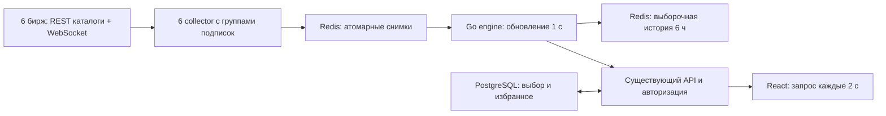

# Простой арбитраж: отчёт

Проверено 6 октября 2026, Asia/Vladivostok. Обновлённый сайт: **http://192.168.0.124/arbitrage**, обычный вход. [Первоначальный отчёт](report-initial.md) сохранён как история версии `fb41cba`.

## Страница

Одна панель: три режима, поиск монеты, шесть бирж и таблица. Режимы: спот–фьючерс, фьючерс–фьючерс, спот–спот. Колонки: **Монета → Купить → Продать → Разница → Доступно, USDT → Длительность**. Цена находится под названием биржи; положительная разница выделена зелёным. Сортировка — по разнице.

Избранное, пауза, подробности двух инструментов, ссылки на биржи и выборочная история сохранены. Выбор сохраняется автоматически. Поиск — по части тикера, включая 1INCH и Unicode. Нужны минимум две биржи. До 100 строк на странице, полный счётчик и пагинация. Если число связок уменьшилось, сервер возвращает последнюю существующую страницу. Состояние бирж раскрывается отдельно: рынки, свежие книги и подключённые группы.

Из [SpreadScan](https://spreadscan.com) взята последовательность Pair / Buy / Sell / Spread; из [ArbiLayer](https://arbilayer.com/arbitrage) — типы связок, цена под биржей и подробности строки. Изучены публичные превью [ArbitrageScanner](https://arbitragescanner.io/about-perp-screener). Подробности исследования и концепт: [design-simple.md](design-simple.md). Закрытые backend конкурентов неизвестны; наша архитектура реализована под текущий проект и публичные API бирж.

## Что работает иначе

| Раньше | Теперь |
| --- | --- |
| Фиксированные 30 монет | Полные активные поддерживаемые USDT-каталоги шести бирж |
| Бюджет, минимум спреда, комиссии, funding, сценарий выхода и дополнительные настройки | Режим, поиск монеты, биржи; разница цен сохранена |
| VWAP для выбранной суммы | Лучший ask покупки и лучший bid продажи, общий доступный объём |
| Кнопки сохранить/сбросить | Автоматическое сохранение с последовательной записью |
| Избранное среди верхних результатов | Поиск избранных ID по всей выдаче с текущими фильтрами, до 200 |
| Крупные подписки в одном соединении | Независимые группы с ограничением частоты подписок |
| Ошибка одной книги могла отключать группу | Неверный инструмент исключается отдельно |
| Gate: тяжёлый spot depth и старый futures snapshot/delta | Spot/futures book_ticker с актуальными лучшими ценами и количеством |
| Совпадение тикеров | Разделены обнаруженные разные UP; фондовый EWT исключён по типу контракта |

Старые сохранённые бюджет, комиссии и список монет не ограничивают простой экран. Сохраняются допустимые режим, биржи, поиск и избранное. Старый расчёт оставлен в engine при явном `simple=false` для совместимости и тестов; новый UI его не вызывает. Активный опрос funding прекращён, поэтому старый сценарий без свежих ставок остаётся неопределённым.

Существующие Header, авторизация, основной выбор биржи на сканерах, общие темы и SegmentedControl используются как раньше. Глобальные токены и остальные страницы этой доработкой не изменены. Исходная интеграция маршрута/меню и семь процессов уже были добавлены предыдущим коммитом.

## Backend и расчёт



Самостоятельный Go-модуль `backend/arbitrage`. Engine не публикует внешний порт. Redis/PostgreSQL общие, ключи и пользовательская таблица отдельные. Биржевые соединения не зависят от числа посетителей. API сохраняет авторизацию, защиту cross-site записи и доступ к настройкам только текущего пользователя.

Каталоги: активный спот и линейные бессрочные USDT-фьючерсы Binance, Bybit, OKX, Bitget, Gate.io, KuCoin. Пагинация Bybit поддержана. Инверсные/срочные и известные не-криптовалютные Gate-контракты исключаются. Обновление каталога каждые 30 минут. `ARBITRAGE_ASSETS=*` по умолчанию; административный список по-прежнему возможен.

Группы: Binance 200 инструментов; Bybit/OKX 100; Bitget/KuCoin 40; Gate 50. Соединения и подписки запускаются постепенно; чтение и heartbeat работают во время подписки. При разрыве недействительны книги только этой группы. Bybit reset `u=1` поддержан; старые кадры не заменяют новые.

Collector каждые 500 мс атомарно заменяет Redis-хеш: DEL + один HSET в транзакции. Исходное время котировки сохраняется; удалённые рынки исчезают. Engine декодирует каждую книгу один раз и обновляет снимок каждую секунду. Повторяющиеся книги в HTTP передаются один раз.

```text
разница, % = (лучший bid продажи / лучший ask покупки − 1) × 100
q = округлённый до общего шага минимум количества на этих двух уровнях
доступно, USDT = q × цена покупки
```

Проверяются актив, множитель контракта, общий шаг, минимальный ордер, корректность и свежесть до 10 с. Только положительная разница между разными биржами. Нет скрытого бюджета, комиссий или funding. При старении показатели скрываются; пауза возраст не останавливает. Длительность — непрерывная положительная разница свежих цен, измеренная раз в секунду; обрыв/перезапуск сбрасывает её.

История: до 300 положительных связок каждого режима раз в 30 с, последние 6 ч. Она выборочная; пробелы не соединяются линией.

### Исправленные ложные связки

- **EWT:** Gate futures оказался фондовым инструментом, а спот других бирж — Energy Web Token. Фильтр Gate `contract_type` исключает stocks/metals/indices/forex/commodities. Поле описано в [официальном REST API Gate](https://www.gate.com/docs/developers/apiv4/en/futures/).
- **UP:** Superform на Bitget/KuCoin spot и Unitas на OKX/Gate — разные активы. Добавлен `assetIdentity`, разделение расчёта/длительности и подпись названия в UI. Непроверенные UP изолированы по бирже/рынку. Источники: [Bitget Superform](https://www.bitget.com/zh-CN/support/articles/12560603884056), [KuCoin Superform](https://www.kucoin.com/ja/announcement/jp-superform-up-gets-listed-on-kucoin-world-premiere), [OKX Unitas](https://www.okx.com/en-sg/help/okx-to-list-perpetual-futures-for-up-crypto), [Gate Unitas](https://www.gate.com/es/announcements/article/50650).

Произвольные числовые префиксы не удаляются: 1INCH остаётся 1INCH. Сохранены XBT→BTC и проверенные 1000PEPE/SHIB/BONK/FLOKI.

## Изменённые и созданные файлы

| Файлы | Назначение |
| --- | --- |
| `backend/arbitrage/internal/market/model.go`, тесты | Все монеты, идентичность UP, состояния соединений |
| `internal/exchanges/rest.go`, тесты | Полные каталоги, timeout 45 с, Gate HTTP/1.1, фильтр типов контрактов |
| `internal/exchanges/stream.go`, тесты | Подписки, heartbeat, Gate BBO, изоляция плохих книг |
| `internal/collector/collector.go`, тесты | Независимые соединения, атомарные снимки, прекращение funding-опроса |
| `internal/engine/engine.go`, новый `simple_test.go`, прежние тесты | Простой расчёт, поиск/избранное/offset, разделение активов, совместимость старого расчёта |
| `internal/service/service.go`, тесты | Общий снимок, полный счётчик, пагинация, история/длительность |
| `cmd/engine/main.go`, `cmd/check/main.go` | Режим всех монет и диагностика тех же WS-групп |
| `backend/api/internal/httpapi/arbitrageapi/api.go`, тесты | Простые preferences, Unicode-поиск, размер запроса для избранного |
| `backend/compose.yaml` | `ARBITRAGE_ASSETS=*` |
| `backend/deploy/server/compose.sh`, новый Gate override и routing.py/service/timer | Серверный транспорт Gate через существующий VPN |
| `frontend/web/src/pages/public/arbitrage/ArbitragePage.tsx`, `arbitrage.css` | Простой экран, мобильный вид, три темы, состояние источников |
| `model.ts`, `RouteDetails.tsx` | Простой запрос/миграция выбора, подробности, названия активов |
| `frontend/web/tests/arbitrage.test.mjs`, `arbitrage-live.mjs` | Проверки модели и реального сайта |
| `backend/arbitrage/README.md`, `docs/arbitrage/*simple*`, отчёты | Запуск, спецификация, концепт и доказательства проверок |

Пути `internal/*` и `cmd/*` относятся к `backend/arbitrage`.

## Сервер

Обновлены API, frontend и семь арбитражных процессов в `/opt/shortlong`. Существующие worker, базы, `.env` и доступы сохранены. Копии исходников: `/opt/shortlong/reports/arbitrage-fb41cba/source-before.tar.gz` и `/opt/shortlong/reports/arbitrage-simple/source-before.tar.gz`. Логи сборок/интеграций находятся в последней папке.

Повторная проверка примерно через 20 часов: API, frontend и engine healthy; остальные арбитражные процессы running. Старые worker и хранилища продолжают работать около двух недель. [Свежий снимок покрытия](coverage-simple.json): 2 191 монета с котировками и 1 066 связок в базовом режиме на момент снимка; числа меняются постоянно. Это отдельный снимок от браузерного теста с 1 714 монетами.

Прямой маршрут Gate на server01 сильно замедлял полный каталог. Только Gate collector получил дополнительную сеть 172.31.254.0/24, адрес .2, MTU 1420. Правило 32120 направляет **источник 172.31.254.2** в существующую таблицу 51820 / awg0. Общий маршрут и транспорт других сервисов не изменены. Redis доступен через обычную Docker-сеть. Systemd timer восстанавливает наше правило; VPN и его ключи не менялись. Нужен уже работающий VPN. Серверный override использует gw_priority: [Compose ≥2.33.1](https://docs.docker.com/reference/compose-file/services/#gw_priority), на server01 — 2.40.3. Локальный Compose override не использует.

Gate BBO проверен реальными кадрами и [официальным spot WS](https://www.gate.com/docs/developers/apiv4/ws/en/), [futures WS](https://www.gate.com/docs/developers/futures/ws/en/). Передаются лучшие цены и количество без тяжёлой полной глубины.

## Проверки

- **9 Go-модулей**: `go test ./...` и `go vet ./...` успешно. [Вывод](go-verification-simple.json). Интеграции, пропускаемые без переменных хранилищ, выполнены отдельно.
- Frontend build и lint успешно; **29 Node-тестов** арбитража, analytics, replay, scanner-window и smart-money успешно.
- `go test -race ./... -count=1` арбитража с отдельным Redis успешно. Производственные базы для тестовых записей не использовались.
- API: **5 тестов**, включая отдельный PostgreSQL, изоляцию разных пользователей и Unicode-поиск, успешно.
- Playwright/Edge на реальном сайте: **18 проверок** успешно. Все 12 spot/perpetual источников; цены/объём; UP/EWT/Unicode; режимы, темы, избранное, автосохранение/reload, пагинация, пауза/старение, подробности/Escape/focus, мобильный 390 px, пустой/неверный поиск, авторизация/cross-site защита. Открыты также scanner, replay, backtest и account. [Результат](browser-verification-simple.json).
- Существующий backtest E2E: **2 теста пропущены** — отсутствует `BACKTEST_E2E_SESSION` изолированного стенда. Открытие страницы в браузере их не заменяет.

## Дизайн и ограничения

[Концепт](concept-simple.png) сопоставлен через `view_image` с [актуальным desktop light](simple-desktop-light.png) при 1536×1024. Проверены [dark](simple-desktop-dark.png), [green](simple-desktop-green.png), [mobile](simple-mobile-light.png) и [подробности](simple-route-details.png). Browser/IAB не предоставил поверхностей, использован Playwright/Edge. Леджер пяти и более контрольных точек, copy diff и намеренные отличия: [design-simple.md](design-simple.md). Реализация проверена на соответствие концепту с указанными отличиями; существенных непредусмотренных расхождений не осталось.

«Все монеты» — все поддерживаемые активные **USDT**-рынки. Каталог не равен свежему покрытию: тихие рынки и обрывы исключаются; фактические числа показываются. Нет гарантии котировки каждого инструмента в каждый момент.

Каждые 30 минут при обновлении каталога текущая версия пересоздаёт группы рынка; на время постепенного подключения покрытие может уменьшаться. Независимые переподключения также дают частичный статус. Непрерывное обновление подписок без пересоздания групп пока не реализовано.

Разница не является чистой прибылью: исполнение, комиссии, funding, переводы, заём, маржа и ликвидация не рассчитаны. «Доступно» относится только к лучшим уровням. Для спот–спот нужны средства на обеих биржах. UP и фонд EWT исправлены, но автоматической проверки адресов контрактов/сетей **всех** новых токенов пока нет; другие коллизии и переименования требуют подтверждённого сопоставления. История выборочная; длительность после перезапуска начинается заново. Уведомления и отправка ордеров не добавлены.
