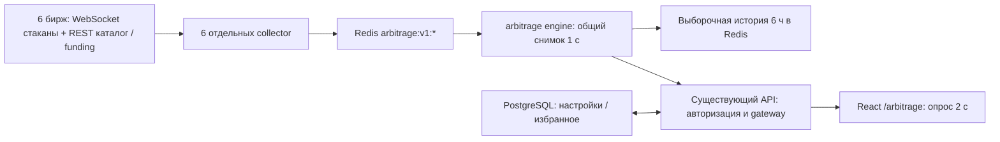

# Реализация арбитража

Дата проверки: 5 октября 2026. Страница `/arbitrage` встроена в существующий сайт; backend работает отдельным Go-модулем и отдельными процессами. Это сканер и калькулятор, без торговли.

## Что реализовано

| Область | Результат |
| --- | --- |
| Биржи | Binance, Bybit, OKX, Bitget, Gate.io, KuCoin; публичные спот и бессрочные USDT-фьючерсы |
| Режимы | Спот–фьючерс, фьючерс–фьючерс, спот–спот |
| Поиск | Размер покупки, минимум спреда, список монет, шесть переключателей бирж, сортировки, лимит результатов, максимальный возраст данных, разрешение связок внутри одной биржи |
| Расчёт | Покупка по asks, продажа по bids, VWAP по доступной глубине, одинаковое количество монеты на обеих ногах, общий шаг количества и минимальный ордер |
| Комиссии | Публичные базовые taker-тарифы либо пользовательское переопределение; отдельно вход и выход |
| Funding | Направление платежа каждой ноги, индивидуальное расписание и количество начислений в выбранном горизонте; при отсутствии актуальной ставки итог не подставляется |
| Управление | Сохранение фильтров, сброс, избранное, пауза; данные индивидуальны для пользователя |
| Подробности | Стаканы обеих ног, цены по объёму, количество, комиссии, funding, ссылки на инструмент, результат заданного сценария закрытия, выборочная история спреда |
| Состояния | Загрузка, ошибка API/Redis, отсутствующие источники, пустой результат, устаревший снимок, отсутствие funding и истории |

Во время реальной проверки данные поступали от всех шести бирж. Точное покрытие по каждому рынку сохранено в [browser-verification.json](browser-verification.json). Количество инструментов отличается между биржами; не все 30 заданных монет доступны на всех рынках.

## Как устроен backend



Каждый collector держит отдельные соединения для спота и фьючерсов. При разрыве его стаканы помечаются недействительными, затем он переподключается. Полные снимки восстанавливают Redis-хеш даже после потери ключа, сохраняя исходные времена котировок. Bybit restart-снимок с `u=1` принимается; более старые данные не заменяют новые.

Проверяются тип и состояние инструмента, USDT-котировка/расчёт, множитель контракта, цена и количество, порядок уровней, некроссированный стакан и свежесть. Метаданные и funding проверяются отдельно. Подписки используют протокол конкретной биржи; дельты не выдаются за полные снимки. У Gate futures принимается `event=all`, у Bitget — snapshots `books5`, у KuCoin — публичная конфигурация сервера.

Биржевой транспорт не зависит от числа посетителей. Повторяющиеся стаканы вынесены в словарь ответа, поэтому одна книга не передаётся для каждой пары заново. Новые процессы используют существующий Redis и PostgreSQL; бизнес-логика и пространство ключей отделены от текущих сканеров. Полной физической изоляции общей инфраструктуры нет.

Engine не опубликован отдельным внешним портом. В API добавлены ограничения размера/времени ответа, проверка авторизации, JSON и защиты от cross-site записи. Настройки читаются и изменяются только по ID текущего пользователя. Проверка истории принимает только корректный ID связки, адрес upstream задаётся администратором.

Протоколы сверялись с первичными источниками, включая [Bybit orderbook](https://bybit-exchange.github.io/docs/v5/websocket/public/orderbook), [Gate futures WebSocket](https://www.gate.com/docs/developers/futures/ws/en/), [KuCoin depth snapshots](https://www.kucoin.com/docs-new/3470083w0) и [обновление Binance Futures WebSocket](https://www.binance.com/en-ZA/support/announcement/detail/ebf9b0aa9eca4ff3804eef6fb09ba32a). Подключение дополнительно проверено реальными данными, а не только описанием API.

## Что означают числа

Для количества `q`, цены покупки `B` и продажи `S`:

```text
спред входа = (S / B − 1) × 100 %
комиссии входа = q × B × feeBuy + q × S × feeSell
после комиссий входа = [q × (S − B) − комиссии входа] / (q × B) × 100 %
```

Для хеджированной позиции сценарий закрытия учитывает базис входа, заданный спред выхода, четыре комиссии и funding обеих ног. Он предполагает неизменную цену первой ноги и постоянные текущие ставки funding до конца горизонта. Следовательно, это оценка при заданных условиях, а не реализованная прибыль.

Спот–спот считает разницу одновременной покупки и продажи с двумя комиссиями. Для него нужны заранее размещённые средства на обеих биржах. Перевод, вывод, сеть и восстановление балансов не входят в расчёт.

Возраст котировки берётся по более старому времени биржи/получения. По умолчанию предел 10 с, настройка 1–30 с действительно применяется сервером. Пауза останавливает запросы, но не останавливает старение. Длительность измеряется независимо от суммы пользователя: непрерывный положительный спред лучших цен при свежести 10 с, с разрешением 1 с.

## Ограничения текущей версии

- По умолчанию задан проверенный список 30 монет. Это не сканирование всех листингов; список меняется через `ARBITRAGE_ASSETS` с проверкой идентичности новых активов.
- Bybit даёт только первый уровень. У остальных используется до пяти. Если этого объёма недостаточно для выбранной суммы, связка исключается; объём полного стакана не предполагается.
- VIP-тариф, скидки, заём, маржа, риск ликвидации и исполнение/максимальные ограничения реального ордера не подтверждаются. Это публичная оценка возможности.
- Если тариф отсутствует в публичном каталоге, используется заданный базовый ориентир; неизвестная комиссия не считается нулевой. Комиссии оценены в USDT, фактическая валюта их списания и резерв средств не проверяются.
- История выборочная: каждые 30 с до 300 связок каждого режима при серверных базовых фильтрах (1000 USDT, от −1 %, свежесть 10 с), последние 6 ч. У некоторых связок история будет пустой или с пропусками; график не соединяет большие пробелы.
- Избранное хранит ID до 200 связок. Оно показывает сохранённые связки среди результатов текущих фильтров и лимита, не гарантирует их постоянное присутствие.
- Уведомления и автоматическое исполнение не добавлены. API ключей бирж, переводов и отправки внешних сообщений у нового сервиса нет.

## Изменения существующего поведения

1. В авторизованной навигации появился пункт «Арбитраж», также в мобильном меню.
2. `/arbitrage` требует обычного входа, но не выбора одной основной биржи: здесь выбираются сразу несколько. Поведение выбора основной биржи на сканерах сохранено.
3. Переключатель режимов сканера вынесен в общий `SegmentedControl` и использован на новой странице. Геометрия, цвета, spring-анимация и эффект нажатия сохранены; добавлена доступная семантика выбранной кнопки и клавиатурный фокус.
4. Общий Compose теперь включает ещё семь сервисов. Обычный запуск всех сервисов запускает и арбитраж; источник логов и потребление Redis увеличиваются.
5. Добавлены четыре авторизованных API маршрута и одна таблица PostgreSQL. Существующие маршруты и таблицы сканеров не заменены.

В `App.tsx` и `Header.tsx` были внесены только изменения интеграции. Уже существовавшие пользовательские правки в этих файлах, `index.css` и `MarketTickerMarquee.tsx` сохранены. Глобальные токены сайта не переопределялись.

## Соответствие стилю сайта

Основной эталон — [существующий сканер](reference-site.png). [Концепт](concept.png) использован для композиции; точные параметры взяты из исходного сайта.

| Контрольная точка | Реализация и проверка |
| --- | --- |
| Header и темы | Существующий Header и ThemeProvider, новый пункт меню; никаких отдельных тем страницы |
| Ширина | `max-w-7xl`, на desktop 1536 px панель x=152 и шириной 1232 px |
| Типографика | Заголовок 36 px desktop / 30 px mobile; семантические foreground/muted-foreground |
| Панели | Радиус 16 px, рамка 1 px, исходные card/background; без декоративных градиентов |
| Поля и кнопки | Исходные классы ScannerConfig: радиус 12 px, поле высотой 42 px, одинаковые padding/focus-ring |
| Выпадающие списки | Исходный AnimatedSelect: portal, анимация, клавиатура, положение относительно viewport |
| Переключатели | Общий компонент, извлечённый из ScannerConfig; прежний spring 520/38/0.7 и whileTap 0.98 |
| Ползунок | Track 8 px, thumb 18 px, primary/ring из темы; клавиатурная регулировка |
| Мобильная версия | Перенос режимов/бирж, вертикальные поля, горизонтальный скролл таблицы внутри панели; ширина страницы не выходит за 390 px |
| Диалог | Нативный modal-dialog, Escape, возврат фокуса, блокировка прокрутки фона и единые цвета сайта |

Размеры панели и поля в трёх темах совпали при браузерном измерении. Скриншоты: [Light](desktop-light.png), [Dark](desktop-dark.png), [Green](desktop-green.png), [mobile Light](mobile-light.png), [mobile Dark](mobile-dark.png), [mobile Green](mobile-green.png), [подробности](route-details.png).

## Проверки

- `go test ./... -count=1` и `go vet ./...` во всех девяти Go-модулях — успешны. [Сводка](go-verification.json).
- Миграции API проверены на новой отдельной БД. Первый запуск smoke-теста на старой частично заполненной тестовой базе упал на отсутствующей таблице `alerts`; повтор на чистой БД прошёл. Рабочая база сайта не очищалась.
- PostgreSQL-интеграции настроек проверяют сохранение, чтение и отсутствие доступа между двумя пользователями. Redis-интеграции — потерю статуса, сброс длительности, историю и восстановление ключа без изменения времени котировки.
- Внешние форматы всех шести бирж проверены фикстурами: каталоги обоих рынков, масштабы контрактов, snapshots, ошибки подписки, запрет частичных дельт, пустой/нечисловой funding и pagination Bybit.
- Расчётные тесты: четыре комиссии, знаки и расписания funding, отсутствующий funding, общий шаг, VWAP/бюджет, недостаточный объём, свежесть и режимы.
- `go test -race ./...` нового backend — успешен, включая Redis-интеграции, в Linux-контейнере.
- Node-тесты фронтенда: **42 прошли**, включая существующие тесты сканера, аналитики, replay, backtest, similarity и Smart Money.
- `npm run build`, `npm run lint` и Docker-сборки — успешны.
- Реальный браузер: [19 проверок](browser-verification.json), без моков котировок и авторизации. Включены темы, меню, клавиатура, фильтры, режимы, диалог, сохранение и повторный вход на страницу, старение после паузы, авторизация и cross-site запрет. Дополнительно проверена видимость пустого результата на мобильном экране: сообщение находится вне горизонтальной прокрутки таблицы. Существующие scanner/backtest/replay/account проверены на отображение.
- Дополнительно выполнены изолированные интеграции similarity с PostgreSQL, Redis, ClickHouse и Qdrant, а также backtest-интеграции Go.
- Два существующих Playwright backtest E2E-теста пропущены самим набором: не настроена сессия отдельного пользователя изолированного полного API/worker-стека. Платные OpenAI live-тесты не запускались. Успешные проверки не означают, что выполнены эти opt-in сценарии.

Локальный ориентир: перебор 30 монет × 6 бирж × 2 рынка — около 2 мс на Ryzen 5 5600H в синтетическом Go benchmark. В одном замере семь процессов использовали суммарно примерно 79 MiB RAM, без учёта общего Redis/PostgreSQL. Это замер данного окружения, не гарантия производственной пропускной способности.

В [реальном замере HTTP](runtime-measurement.json) 80 связок использовали 34 уникальных стакана. Ответ занимал около 126 KB вместо 167 KB при повторении стаканов в каждой строке: примерно на 25 % меньше до HTTP-сжатия.

## Файлы

| Файлы | Назначение |
| --- | --- |
| `backend/arbitrage/go.mod`, `go.sum`, `Dockerfile`, `.dockerignore` | Независимый модуль, runtime и тестовый Docker target |
| `backend/arbitrage/cmd/{collector,engine,check}/main.go` | Запуск процессов и необязательная реальная проверка подключения |
| `backend/arbitrage/internal/market/*` | Модель инструмента/стакана, aliases, свежесть и VWAP |
| `backend/arbitrage/internal/exchanges/*` | Шесть адаптеров REST/WebSocket и тесты протоколов |
| `backend/arbitrage/internal/collector/*` | Соединения, funding, повторные подключения и публикация Redis |
| `backend/arbitrage/internal/engine/*` | Расчёт связок, ограничения, сортировка и экономика |
| `backend/arbitrage/internal/service/*` | Общий снимок, статусы, duration, история и внутренний HTTP |
| `backend/api/internal/httpapi/arbitrageapi/*` | Авторизованный gateway, индивидуальные настройки, интеграционные тесты |
| `backend/api/internal/database/migrations/070_arbitrage.sql` | Новая таблица |
| `backend/api/internal/database/migrations_smoke_test.go` | Проверка новой таблицы в миграционном smoke-тесте |
| `backend/api/cmd/api/main.go` | Регистрация маршрутов с обоими существующими API prefixes |
| `backend/compose.yaml` | Семь новых сервисов, healthcheck engine и адрес gateway |
| `frontend/web/src/pages/public/arbitrage/*` | Страница, диалог, модели и CSS |
| `frontend/web/src/shared/ui/SegmentedControl.tsx` | Общий переключатель из существующего сканера |
| `frontend/web/src/pages/public/scanners/ScannerConfig.tsx` | Использование общего переключателя вместо локальной копии |
| `frontend/web/src/app/App.tsx`, `shared/ui/Header.tsx` | Lazy-route, меню, исключение single-exchange gate |
| `frontend/web/tests/arbitrage*.mjs`, `package.json` | Модельные и реальные браузерные проверки, команды запуска |
| `docs/arbitrage/*`, `backend/arbitrage/README.md` | Отчёт, инструкции и доказательства проверки |

Код не коммитился и не публиковался на внешний сервер. Локальный сайт и новые сервисы запущены. Инструкция повторного запуска и тестов: [backend/arbitrage/README.md](../../backend/arbitrage/README.md).
